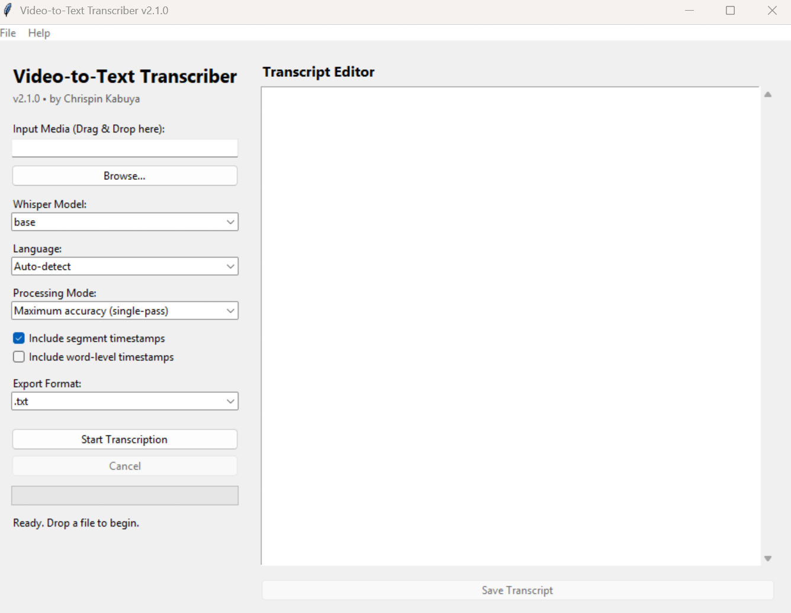

# Video-to-Text Transcriber

A free Windows desktop application for converting video and audio recordings into text using OpenAI Whisper.
 


## Features

- Select a video or audio file using a file browser.
- Choose where to save the generated transcript.
- Select a Whisper model to balance speed and transcription quality.
- Generate plain-text transcripts with optional timestamps.
- Run transcription locally on your computer.
- Display processing status and elapsed time.

## Requirements

- Windows
- Internet access for the initial Whisper model download
- FFmpeg available to Whisper
- Python 3.11 for running from source

## Run from source

```bash
python -m venv myenv
myenv\Scripts\activate
python -m pip install -r requirements.txt
python video_to_text.py
```

## Download for Windows

Visit the repository's **Releases** page and download the latest Windows distribution.

Extract the ZIP file and run `VideoToText.exe`.

The first run may take longer while the selected Whisper model is downloaded. The application requires sufficient memory and disk space for the selected model.

## Privacy

Transcription is performed locally using Whisper. The application does not intentionally upload recordings to a transcription service. An internet connection may be used to download model files.

## Limitations

Transcription speed and accuracy depend on the selected model, recording quality, language, background noise and available hardware. The application does not guarantee perfect transcription.

## Licence

See the LICENSE file for the licence terms applicable to this project.

See the [Roadmap](ROADMAP.md) for upcoming features.